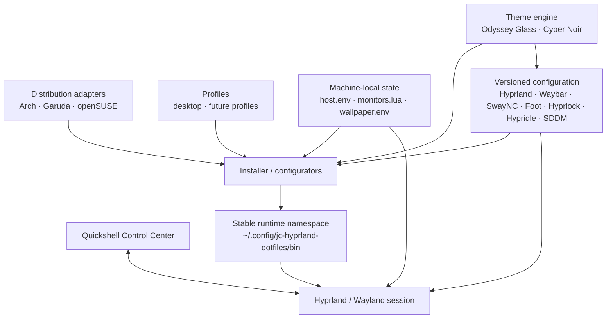
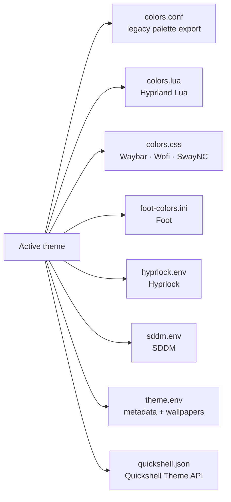
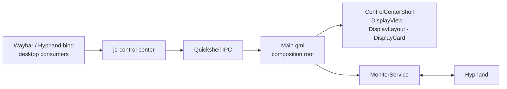
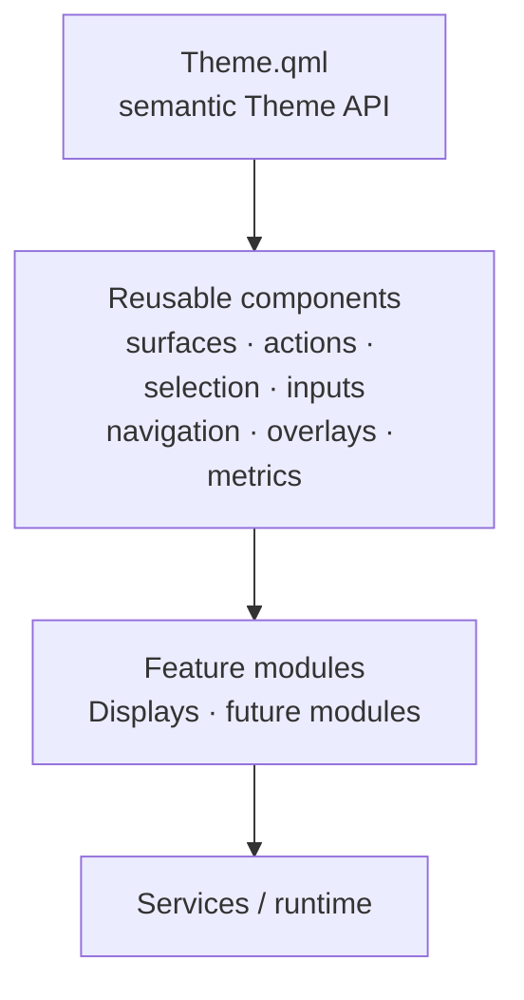
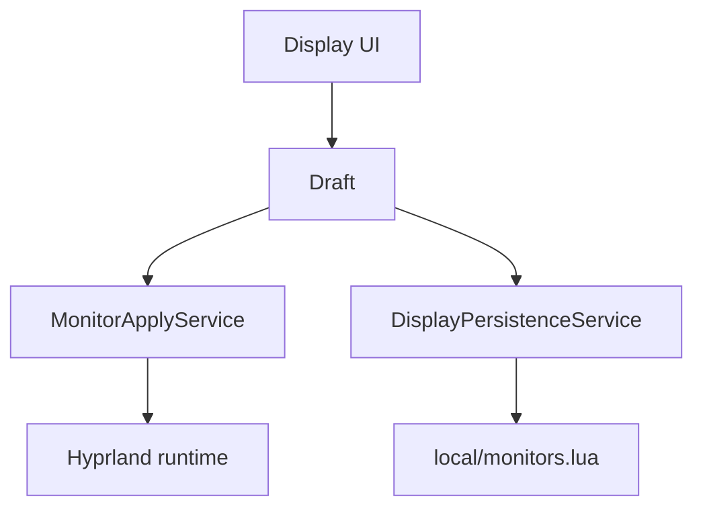
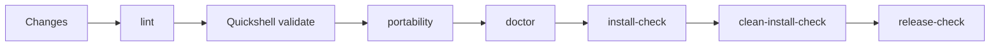
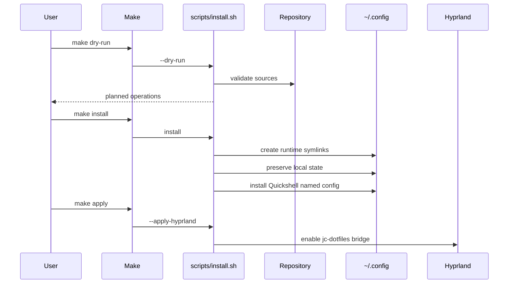

# Arquitectura

`jc-hyprland-dotfiles` está diseñado como un entorno Hyprland **modular, portable,
theme-driven y consciente del hardware**, evitando convertir toda la configuración
del escritorio en un único bloque acoplado a una distribución o máquina.

La arquitectura separa deliberadamente:

- configuración reutilizable,
- adaptadores de distribución,
- estado local de la máquina,
- runtime,
- temas,
- UI/Control Center,
- automatización y quality gates.

---

## Objetivos de arquitectura

Los principios principales son:

1. **Separación de responsabilidades**  
   Cada capa debe tener una responsabilidad clara y mínima.

2. **Portabilidad entre distribuciones**  
   Las diferencias de Arch, Garuda y openSUSE viven fuera de la configuración
   común del escritorio.

3. **Portabilidad entre máquinas**  
   Monitores, GPU, wallpapers locales y otros datos del host no deben quedar
   hardcodeados en Git.

4. **Runtime desacoplado**  
   Waybar, binds y otros consumidores no deben conocer detalles internos de
   implementación cuando existe un wrapper estable.

5. **Temas como contrato visual**  
   Los componentes consumen formatos específicos del tema activo sin conocer
   directamente qué tema fue seleccionado.

6. **Configuración segura y reversible**  
   La instalación favorece symlinks, bridges y archivos locales preservados.

7. **Evolución incremental**  
   Nuevas capacidades —como Quickshell— se agregan como módulos y servicios,
   no como lógica insertada directamente en componentes existentes.

---

# Vista general



La idea central es que **ninguna capa inferior deba conocer innecesariamente
detalles de una capa superior**.

---

# Capas del proyecto

## 1. Distribución

Ruta:

```text
distros/
├── arch/
├── garuda/
└── opensuse/
```

Responsabilidad:

- paquetes,
- diferencias de package manager,
- integración específica de la distribución,
- preparación de dependencias.

No debe contener:

- configuración de monitores,
- temas,
- reglas Waybar,
- estado local del usuario.

La configuración común del escritorio debe seguir funcionando sin conocer qué
adaptador de distribución la instaló.

---

## 2. Perfiles

Ruta:

```text
profiles/
└── desktop/
    └── profile.env
```

Responsabilidad:

- definir el tipo lógico de estación,
- habilitar módulos o políticas de escritorio,
- servir como futura frontera para perfiles como:
  - desktop,
  - laptop,
  - workstation,
  - gaming,
  - minimal.

Un perfil no debe almacenar datos físicos de una máquina concreta.

---

## 3. Configuración reutilizable

Ruta principal:

```text
config/
```

Contiene configuración compartida de:

```text
foot
hypr
hypridle
hyprlock
quickshell
sddm
swaync
systemd
waybar
wofi
```

Regla:

> `config/` no debe contener identidad de máquina, seriales de monitor,
> direcciones PCI personales ni rutas absolutas de usuario.

Esta regla permite que el mismo checkout pueda reutilizarse en diferentes hosts.

---

## 4. Estado machine-local

El estado físico y personal vive fuera del checkout:

```text
~/.config/jc-hyprland-dotfiles/local/
├── host.env
├── monitors.lua
└── wallpaper.env
```

### `host.env`

Responsabilidad:

- roles de monitor,
- workspaces por rol,
- perfil,
- hardware opcional.

### `monitors.lua`

Responsabilidad:

- configuración persistente de monitores del host.

### `wallpaper.env`

Responsabilidad:

- overrides locales,
- rotación,
- intervalos,
- target de wallpaper.

Estos archivos se preservan durante reinstalaciones y actualizaciones.

---

# Runtime namespace

El checkout del repositorio no debe convertirse en una API implícita para todos
los consumidores.

El instalador expone un namespace estable:

```text
~/.config/jc-hyprland-dotfiles/
├── repo -> /path/to/jc-hyprland-dotfiles
├── theme -> /path/to/repo/themes/<active-theme>
│
├── bin/
│   ├── amd-gpu.sh
│   ├── apply-wallpaper.sh
│   ├── jc-control-center
│   ├── jc-displaycfg
│   ├── jc-displayctl
│   ├── jc-theme
│   ├── launch-foot.sh
│   ├── launch-wofi.sh
│   ├── lock-session.sh
│   ├── network-traffic.sh
│   ├── rotate-wallpaper.sh
│   ├── start-quickshell.sh
│   ├── start-swaync.sh
│   ├── start-waybar.sh
│   ├── suspend-session.sh
│   └── wallpaper-manager.sh
│
└── local/
    ├── active-theme
    ├── host.env
    ├── monitors.lua
    └── wallpaper.env
```

Esto permite que consumidores externos usen:

```text
jc-control-center toggle
```

en lugar de conocer directamente:

```text
qs -c jc-hyprland ipc call controlCenter toggleControlCenter
```

El wrapper funciona como una pequeña API de runtime.

---

# Arquitectura de temas

Ruta:

```text
themes/
├── cyber-noir/
└── odyssey-glass/
```

Cada tema implementa un contrato común:

```text
theme.env
colors.conf
colors.css
quickshell.json
colors.lua
foot-colors.ini
hyprlock.env
sddm.env
wallpapers/
```

El tema activo se expone mediante:

```text
~/.config/jc-hyprland-dotfiles/theme
```

Los consumidores no deben necesitar saber si el tema actual es `odyssey-glass`,
`cyber-noir` u otro futuro.



---

# Arquitectura de Hyprland

El runtime soportado es **Lua-only** para Hyprland 0.55+ y la base actualmente
validada es Hyprland 0.56.2.

```text
~/.config/hypr/hyprland.lua
        │
        └── require("jc-dotfiles/init")
                         │
                         ├── theme.lua
                         ├── appearance.lua
                         ├── gaming.lua
                         ├── animations.lua
                         ├── autostart.lua
                         ├── local/monitors.lua
                         └── keybindings.lua
```

La configuración del proyecto se carga como overlay después de la configuración
base de la distribución. Esto permite que el proyecto y el estado local del host
tengan precedencia sin mantener un fork completo de la configuración de la
distribución.

La configuración física persistente de monitores tiene una sola fuente:

```text
~/.config/jc-hyprland-dotfiles/local/monitors.lua
```

Los dos backends de display consumen esa misma fuente:

```text
local/monitors.lua
      │
      ├── jc-displayctl
      │      runtime mutation / Safe Apply / rollback
      │
      └── jc-displaycfg
             preview / backup / atomic persistence / restore
```

El antiguo camino Hyprlang no forma parte del runtime soportado. Los temas pueden
conservar exports de paleta heredados para otros consumidores, pero la
configuración de Hyprland se genera y ejecuta mediante Lua.

---

# Quickshell Control Center

Quickshell introduce una nueva capa visual de control, pero no reemplaza la
separación existente.

Ruta:

```text
config/quickshell/jc-hyprland/
├── shell.qml
├── Main.qml
├── components/
├── modules/
├── services/
└── theme/
```

Arquitectura actual:



## Responsabilidades

### `shell.qml`

Solo:

- define el `ShellId`,
- instancia la composición principal.

No debe contener lógica de monitor.

### `Main.qml`

Responsabilidad:

- composición,
- visibilidad,
- screen target,
- IPC.

No debe consultar directamente `hyprctl`.

### `MonitorService.qml`

Responsabilidad:

- estado observado de monitores,
- normalización de datos,
- integración Hyprland/`hyprctl`,
- `availableModes`.

No debe decidir colores ni layout visual.

### `modules/displays/*`

Responsabilidad:

- representación,
- interacción visual,
- composición de controles.

No debe ejecutar directamente comandos de configuración.

---

# Biblioteca reutilizable de componentes QML

Phase 2A.2 agrega una capa visual explícita entre `Theme.qml` y los módulos de
funcionalidad:



```text
Theme.qml     vocabulario visual semántico
components/   presentación + interacción reusable
modules/      composición de funcionalidad
services/     estado / draft / orquestación backend
runtime       integración y mutación externa
```

Los componentes Phase 2 reciben el Theme API y no deben ejecutar comandos de
shell, mutar Hyprland ni convertirse en propietarios del estado de negocio.

La compatibilidad visual Phase 1 (`JcCard` y aliases legacy del Theme API) fue
retirada en Phase 2A.4.7 después de migrar sus últimos consumidores a la API
canónica de Phase 2.

Referencia: `docs/component-library.md`.

La galería `modules/dev/ComponentGallery.qml` instancia la biblioteca completa
a través del mismo target IPC `controlCenter`, sin procesos runtime adicionales.

---

# Arquitectura del Control Center shell

Phase 2A.3 consolidó un único shell de producción alrededor de los módulos del
Control Center.

El contrato detallado vive en:

```text
docs/control-center-shell.md
```

La separación principal será:

```text
Main.qml                 composición / estado de navegación / guards
ControlCenterShell.qml   PanelWindow + navegación + content host
feature modules          UI específica
services                 estado y orquestación de backend
runtime wrappers         integración externa estable
```

Los métodos IPC específicos de Displays se conservarán temporalmente como
adaptadores de compatibilidad mientras el wrapper estable migra internamente al
IPC genérico del Control Center.

Safe Apply y persistencia bloquean tanto el cierre como la navegación fuera de
Displays mientras exista una operación que requiera confirmación o guardado.

---

# Estado observado, draft y aplicado

El Control Center mantiene cuatro estados deliberadamente separados:

```text
Observed State
      │
      ▼
   Draft State
      │
      ▼
Applied Runtime State
      │
      ▼
Persistent State
```

## Observed State

Lo que Hyprland está ejecutando actualmente.

Responsable:

```text
MonitorService
```

## Draft State

Cambios seleccionados por el usuario todavía no aplicados.

Responsable:

```text
DisplayDraftStore
```

## Applied Runtime State

Resultado después de validar y enviar cambios al compositor.

Responsable:

```text
MonitorApplyService + jc-displayctl
```

## Persistent State

Configuración confirmada para sobrevivir reloads y nuevas sesiones.

Responsables:

```text
DisplayPersistenceService
jc-displaycfg
local/monitors.lua
```

Esta separación permite:

- Cancel,
- dirty tracking,
- preview,
- validación,
- rollback,
- persistencia independiente.

---

# Runtime vs persistencia

Modificar el runtime y guardar configuración persistente son operaciones
distintas.



Esto evita que un cambio experimental se guarde automáticamente como estado
permanente.

---

# Wallpaper architecture

El subsistema de wallpaper está aislado del Control Center de monitores.

```text
Theme / wallpaper.env
          │
          ▼
 wallpaper-manager.sh
          │
     ┌────┴────┐
     ▼         ▼
   Awww     Hyprpaper
preferred    fallback
```

La rotación usa unidades systemd de usuario:

```text
config/systemd/user/
├── jc-wallpaper-rotation.service
└── jc-wallpaper-rotation.timer
```

La configuración local del intervalo permanece en `wallpaper.env`.

Un cambio de monitor no debe reiniciar arbitrariamente el wallpaper backend;
cada subsistema administra su propio lifecycle.

---

# Quality architecture

La configuración del escritorio se trata como código.



## Gates

### Static

```text
bash -n
ShellCheck
fish -n
JSON / JSONC validation
theme validation
Design System / Theme API validation
Quickshell structural validation
portability check
```

### Runtime

```text
doctor
Hyprland configerrors
runtime dependency checks
runtime symlink integrity
wallpaper lifecycle
notification daemon conflicts
optional Quickshell IPC responsiveness
```

### Release

```text
git diff --check
git diff --cached --check
make check
clean working tree
install-check
clean-install-check
```

---

# Flujo de instalación



---

# Reglas de dependencia

Estas reglas sirven como guía para nuevas funcionalidades:

```text
UI
↓ depends on
service contracts

services
↓ depend on
runtime APIs / commands

runtime wrappers
↓ depend on
implementation details

themes
↓ expose
presentation contracts

local state
↓ contains
machine identity

distro adapters
↓ contain
package/integration differences
```

No debe ocurrir:

```text
theme → serial de monitor
UI → shell command directo
Waybar → detalles internos de QML
distro adapter → configuración visual común
shared config → /home/<user>
```

---

# Estructura arquitectónica resumida

```text
jc-hyprland-dotfiles/
├── config/         reusable desktop configuration
├── distros/        OS/package adapters
├── docs/           architecture and operational documentation
├── hosts/example/  machine-local templates
├── profiles/       logical machine profiles
├── scripts/        install, validation and runtime implementation
├── themes/         visual contracts and assets
│
├── Makefile        developer / operator interface
├── install.sh      public installer entrypoint
├── update.sh       update workflow
├── uninstall.sh    removal guidance
└── VERSION
```

---

# Evolución prevista

La evolución técnica hacia la primera release estable mantiene una secuencia
deliberada: primero consolidar la plataforma visual compartida, después expandir
módulos, posteriormente unificar la experiencia del escritorio y finalmente
ejecutar los gates de release.

```text
Phase 1   Functional foundation                         ✓
    │
    ├── 1A  Display foundation                         ✓
    ├── 1B  Interactive/runtime display control        ✓
    ├── 1C  Persistent display configuration           ✓
    └── 1D  Desktop session integration                ✓
    │
    ▼
Phase 2A  Shared visual platform                 ✓ COMPLETE
    ├── 2A.1  Design System / Theme API          ✓
    ├── 2A.2  Reusable QML Component Library     ✓
    ├── 2A.3  Control Center shell + navigation  ✓
    └── 2A.4  Displays visual redesign           ✓

El contrato de migración visual de Displays vive en:

```text
docs/displays-visual-redesign.md
```
    │
    ▼
Phase 2B–2H
    Control Center modules
    ├── Wallpapers  ← NEXT
    ├── Themes
    ├── Quick Settings
    ├── Performance / Hardware
    ├── Media / Audio
    ├── Network / Bluetooth
    └── Notifications / Calendar / Power
    │
    ▼
Phase 2I
    Desktop visual consolidation / Waybar
    │
    ▼
Phase 3A
    Evaluate native Quickshell bar
    │
    ▼
Release Candidate validation
    ├── UX / visual consistency
    ├── runtime stability / performance
    ├── Garuda clean install
    ├── Arch clean install
    ├── openSUSE clean install
    ├── install / update / uninstall
    ├── documentation / screenshots
    └── final quality gates
    │
    ▼
v1.0.0
FIRST OFFICIAL STABLE RELEASE
```

## Principio para Phase 3A

La migración de Waybar a una barra nativa de Quickshell **no es obligatoria**.
Se realizará únicamente si la implementación nativa aporta ventajas claras en
integración, animación, mantenimiento, estabilidad o experiencia visual.

## Portabilidad

```text
Garuda Linux            validated primary host
Arch Linux              adapter available; clean-install RC pending
openSUSE Tumbleweed     adapter available; clean-install RC pending
```

## Criterio arquitectónico para v1.0.0

La release `v1.0.0` requiere simultáneamente:

- módulos principales del Control Center funcionales,
- Design System compartido,
- componentes QML reutilizables,
- integración visual coherente entre Control Center y barra,
- runtime desacoplado y reversible,
- quality gates completos,
- validación de instalación en las distribuciones objetivo,
- documentación y galería visual de la release.

---

# Regla principal

La arquitectura debe seguir permitiendo que cualquiera de estas piezas pueda
cambiar sin obligar a reescribir las demás:

```text
distribution
hardware
theme
Hyprland config generation
runtime implementation
visual Control Center
```

Ese desacoplamiento es la base del proyecto.


## H1.4 JC Holo interactive controls

Small interactive controls use `JcInteractiveFrame.qml`, a lightweight
presentation primitive that owns the control perimeter, cyan energy rail,
technical top accent, restrained amber detail, and shared state transitions.

`JcHudFrame.qml` remains the panel/card HUD perimeter; it is intentionally not
reused for small controls.

`JcIcon.qml` is the semantic icon boundary. Callers can use `iconName`; the
existing raw `icon` glyph remains a compatibility fallback. This lets the icon
renderer evolve later without rewriting every Control Center module.

H1.4.1 preserves the existing interaction contracts for `JcButton`,
`JcIconButton`, `JcChip`, and `JcChoiceGroup`. H1.4.2 migrates semantic action
icons through active modules after the shared visual language is approved.

### Interactive grouping rule

Decorative framing is not added around a button or choice group merely to
group controls visually. The nearest functional panel or card owns the outer
perimeter; the content area stays clean, and each interactive control owns
only its `JcInteractiveFrame`. Nested framed surfaces are reserved for
independent functional cards. This avoids frame-on-frame overlap and keeps the
JC Holo hierarchy aligned with the Control Center visual reference.

### H1.4.2 semantic action vocabulary

Production actions use semantic `iconName` values instead of embedding visual
glyphs in labels or module code. H1.4.2a establishes the action vocabulary:

```text
apply    -> Apply / Safe Apply
reset    -> Reset
refresh  -> Refresh / recovery refresh
keep     -> Keep confirmed display state
revert   -> Rollback / revert
save     -> Persist configuration
power    -> Enable / Disable display
close    -> Close shell or popup
left     -> Topology left
right    -> Topology right
above    -> Topology above
below    -> Topology below
```

Labels remain present for actions where text improves clarity. The semantic
name is the stable contract; the glyph rendered by `JcIcon` may evolve later
without rewriting feature modules.

Navigation icon migration is intentionally separate in H1.4.2b because
`JcNavItem` still owns a raw-glyph API and requires its own compatibility
migration.

### H1.4.2b navigation semantic icons

`JcNavItem` participates in the same semantic icon boundary as buttons and
chips. It accepts `iconName` as the preferred API while retaining `icon` as a
raw-glyph compatibility fallback.

The Control Center navigation model stores semantic names rather than visual
glyphs:

```text
Displays       -> display
Wallpapers     -> wallpaper
Themes         -> theme
Quick Settings -> settings
Performance    -> performance
Media          -> media
Network        -> network
Notifications  -> notifications
```

Navigation geometry, selection treatment, keyboard semantics, and enabled /
disabled behavior remain owned by `JcNavItem`; H1.4.2b changes only icon
identity and rendering ownership.

### H1.4.3a JC Holo vector icon renderer

`JcIcon` renders known semantic names as self-contained Canvas vectors on
a normalized 24x24 coordinate system. The renderer uses theme-driven icon
color and stroke geometry and does not depend on system icon themes, Nerd
Fonts, Font Awesome, or external SVG assets.

`glyph` remains an explicit compatibility override. When a caller supplies
a raw glyph, `JcIcon` uses the fallback Text renderer; otherwise known
semantic names use the vector path.

This keeps the stable boundary:

```text
feature -> iconName -> JcIcon -> JC Holo vector renderer
                    \-> raw glyph fallback when explicitly requested
```

H1.4.3a changes rendering only. Feature modules, interaction semantics,
keyboard behavior, and control geometry remain unchanged.

### H1.4.3b compact icon differentiation

Compact choice controls use a dedicated 16 px semantic-icon size while
retaining the existing compact control height and padding.

`fit` and `fill` intentionally use different visual metaphors:

```text
fit  -> complete content rectangle contained by viewport brackets
fill -> viewport outline with outward expansion vectors
```

The goal is immediate recognition at compact size rather than micro-detail.
`stretch` and `center` remain unchanged because they were already visually
distinct at the approved H1.4.3a size.

This phase changes only icon rendering and compact icon sizing; semantic
contracts, draft behavior, layout geometry, keyboard interaction, and
feature logic remain unchanged.

### H1.4.3b wallpaper section hierarchy

The Wallpapers module presents two peer sections:

```text
Wallpaper targets -> MAIN / SECONDARY previews and presentation controls
Library           -> catalog source filters and wallpaper gallery
```

The top section reuses `JcSectionHeader`, matching the Library hierarchy
without introducing another framed surface. Library source filters use
semantic icons: `all`, `theme`, and `library`.

This preserves the one-owner-perimeter rule while making the module's
information architecture explicit.

### H1.4.4a Displays visual hierarchy

Displays adopts the same section-first information hierarchy approved for
Wallpapers without flattening independent functional HUD cards:

```text
Monitors
  -> active / detected / draft state + global actions
  -> Layout & position HUD

Monitor settings
  -> one DisplayCard per detected output

Persistent configuration
  -> persistence state + Save Configuration
```

`DisplayLayoutEditor`, `DisplayCard`, Safe Apply confirmation, and persistent
configuration remain independent functional surfaces and therefore retain
their existing perimeter ownership. Section headers provide hierarchy;
additional decorative frames are not introduced.

H1.4.4a is presentation-only. Monitor observation, draft mutation, topology
editing, Safe Apply, rollback, and persistence contracts are unchanged.

### H1.4.4b Display control strip

`DisplayCard` groups the three enumerated monitor settings into a compact
responsive control strip:

```text
Resolution | Refresh rate | Orientation   -> 3 columns when space permits
Scale                                      -> full-width slider below
```

The strip falls back to 2 columns and then 1 column from semantic control
geometry rather than physical-pixel breakpoints.

`JcComboBox` now participates in the canonical JC Holo interactive-control
language through `JcInteractiveFrame`. It exposes a `compact` mode and uses
the semantic `chevron-down` vector from `JcIcon`; selection data, popup
behavior, keyboard focus, and `valueSelected` remain unchanged.

Because `JcComboBox` is shared, the visual treatment also applies to the
topology selectors and future modules without duplicating styling.

## H1.4.4b2 dual-monitor card layout

The Displays module presents monitor settings as responsive peer cards rather
than a vertical list. At normal Control Center width, two `DisplayCard`
instances share one row; below a semantic breakpoint derived from Theme API
control geometry and spacing, the same cards fall back to one column.

Monitor role labels are configuration-derived and remain separate from focus.
The read-only flow is:

```text
local/host.env
  -> start-quickshell.sh
     -> JC_MAIN_OUTPUT / JC_SECONDARY_OUTPUT
        -> MonitorService.qml
           -> roleForOutput(...)
              -> DisplayCard.outputRole
```

`Primary` therefore means the configured `MAIN_OUTPUT`, and `Secondary` means
the configured `SECONDARY_OUTPUT`. Neither role is inferred from the currently
focused monitor, and no output name is hardcoded in QML.

The compact Resolution / Refresh rate / Orientation strip remains three
`JcComboBox` controls and Scale remains `JcSlider`; only the semantic minimum
column width is tightened so all three compact controls can coexist inside a
half-width monitor card when space permits. Existing keyboard, draft,
Safe Apply, rollback, topology, and persistence contracts are unchanged.

## H1.4.4b3 Display card density polish

The dual-monitor layout keeps lifecycle restrictions available without letting
one monitor-specific warning alter peer-card geometry.

`DisplayDraftStore.enableDisableReason(output)` remains the source of truth for
why an enabled display cannot currently be disabled. `DisplayCard` exposes that
reason as read-only presentation state and shows it through `JcTooltip` over the
disabled power action instead of reserving a permanent warning row.

The permanent draft summary and the generic `move required` explanatory footer
are removed from `DisplayCard`. Resolution, refresh rate, orientation, Scale,
observed state, dirty/matching state, and topology validation already expose the
same operational information closer to the controls that own it.

This is presentation-only. Enable/disable guards, draft mutation, topology
validation, Safe Apply, rollback, and persistent configuration semantics remain
unchanged.

## H1.4.4c Compact layout editor

The `Layout & position` HUD keeps the topology canvas unchanged and reduces the
visual weight of the controls beneath it.

The two topology selectors use compact `JcComboBox` controls in the existing
responsive 2/1-column grid. The four direction actions form a compact segmented
strip by composing the existing compact `JcButton` controls with the smallest
canonical gap; their semantic left, right, above, and below icons remain the
interaction language.

The topology-valid state remains visible with caption-level typography, while
the negative-coordinate hint is retained as muted supporting copy. The canvas
therefore remains the focal point without hiding operational information.

Responsive behavior is preserved: selectors fall from 2 columns to 1 and
direction actions from 4 columns to 2. `snapPosition`, `setPosition`,
`snapRelative`, keyboard interaction, Safe Apply and topology mutation
semantics remain unchanged.

## H1.4.4d In-canvas HUD D-Pad

H1.4.4d supersedes the H1.4.4c bottom segmented direction strip. Position
actions now live inside a compact JC Holo D-Pad on the right side of the
topology canvas, matching the visual editing surface that owns those actions.

The canvas reserves a presentation-only right rail for the D-Pad so projected
monitor nodes remain visible and do not render beneath the control cluster.
The four directional icon actions continue to call `snapSelected(...)`, which
delegates to the existing `DisplayDraftStore.snapRelative(...)` draft boundary.

The center action recenters the topology viewport by calling
`recalculateBounds()`. It does not reset or mutate the display draft and does
not apply runtime monitor state.

Selected display and Relative to remain compact selectors below the canvas.
Safe Apply, persistence, topology validation, dragging, snapping, and the
observed/draft/applied/persistent state boundary are unchanged.


## Phase 2B.6.3 Rotation mutation boundary

Automatic wallpaper rotation remains machine-local and separate from per-theme
wallpaper overrides.

```text
QML
  -> jc-wallpaperctl
       -> wallpaper-rotation-manager.sh
            -> local/wallpaper.env
            -> configure-wallpaper-rotation.sh
                 -> systemd user timer drop-in/lifecycle
```

The stable public boundary exposes rotation status and transactional Apply.
The backend serializes mutation with flock, preserves unrelated wallpaper.env
settings, and verifies systemd state before reporting success.

Rotation state is not duplicated into the theme wallpaper preference file.
No QML component owns systemd lifecycle or writes rotation configuration.


## Phase 2B.6.4a Rotation observed and draft foundation

The Wallpapers draft store now separates wallpaper/path-fit edits from
automatic-rotation edits while preserving one observed/draft boundary.

`WallpaperService` observes rotation configuration and runtime synchronization.
`WallpaperDraftStore` owns both draft domains. The existing
`WallpaperApplyService` is explicitly restricted to `hasWallpaperDirty`, so a
future rotation-only draft cannot be sent to `jc-wallpaperctl apply`.

Domain-aware reconciliation prevents a successful wallpaper Apply from
discarding a pending rotation draft. Rotation mutation remains behind
`jc-wallpaperctl rotation apply` and is not activated by QML in this step.


## Phase 2B.6.4b Rotation Apply service boundary

The rotation draft now has a dedicated mutation owner:

```text
WallpaperService (observed)
        |
WallpaperDraftStore (rotation draft)
        |
WallpaperRotationApplyService
        |
jc-wallpaperctl rotation apply
        |
wallpaper-rotation-manager transaction
```

`WallpaperRotationApplyService` mirrors the mature wallpaper Apply lifecycle
without sharing its command surface. Wallpaper/path-fit mutations remain owned
by `WallpaperApplyService`; rotation mutations remain owned by the rotation
service.

Both services refresh the same read-only `WallpaperService`, while
`WallpaperDraftStore.syncAfterApplyDomain` ensures that a successful refresh
accepts only the domain that just committed.

Neither service exposes backend implementation details to feature views.
`Main.qml` owns service lifecycle and transition locking; visible rotation
controls are deferred to Phase 2B.6.5.


## Phase 2B.6.5a Unified wallpaper mutation orchestration

The Wallpapers feature keeps one user-level Apply/Reset surface while
preserving separate mutation owners internally:

```text
                       +-> WallpaperApplyService
WallpaperView
    |
WallpaperMutationCoordinator
    |
                       +-> WallpaperRotationApplyService
```

The coordinator is an orchestration boundary, not a mutation boundary. It
contains no process execution and delegates every write to the existing
transactional services.

For a combined draft, wallpaper/path-fit commits first because its
post-transaction observed refresh can safely preserve the independent rotation
draft. Only after that refresh is reconciled does the coordinator start the
rotation transaction. A failure in the first transaction stops the sequence.

Unified Reset delegates recovery verification to the service that owns the
recovery sentinel before accepting the complete observed wallpaper-module
baseline.

This prepares Phase 2B.6.5b to expose automatic-rotation controls without
creating a second top-level Apply/Reset workflow.


## Phase 2B.6.5b Automatic rotation presentation boundary

Automatic rotation is now visible, but the feature view still owns no backend
mutation logic:

```text
WallpaperRotationControl
        |
        | intent signals
        v
WallpaperView
        |
        | draft setters
        v
WallpaperDraftStore
        |
        | module-level Apply
        v
WallpaperMutationCoordinator
```

`WallpaperRotationControl.qml` is a presentation primitive composed from JC
Holo components (`JcHudFrame`, `JcToggle`, `JcChoiceGroup`, `JcChip`).
Observed runtime status is read-only presentation data.

The rotation panel deliberately shares the existing Wallpapers Apply/Reset
surface. It does not introduce a rotation-specific commit button and therefore
cannot bypass combined-domain sequencing or recovery handling.

The component contains no `Process`, stable CLI invocation, systemd operation,
configuration-file access, service ownership, or draft-store ownership.

Phase 2B.6.5c performs runtime validation of this presentation/draft boundary
and unified orchestration before closure.

## Phase 2B.6 closure — advanced wallpaper controls

Phase 2B.6 closes with the Wallpapers observed/draft/applied/persistent
architecture preserved across wallpaper path, fit and automatic rotation.

```text
Observed runtime/configuration
          |
          v
    WallpaperService
          |
          v
   WallpaperDraftStore
          |
          v
WallpaperMutationCoordinator
      |               |
      v               v
WallpaperApply    RotationApply
   Service          Service
      |               |
      v               v
jc-wallpaperctl   jc-wallpaperctl
     apply         rotation apply
      |               |
      +-------+-------+
              |
              v
       transactional backends
```

`WallpaperMutationCoordinator` is an orchestration boundary, not a mutation
boundary. The feature UI has one Apply/Reset surface while wallpaper/path-fit
and rotation remain separate mutation domains with domain-aware reconciliation.

Combined Apply sequencing is deterministic:

```text
wallpaper/path-fit commit
        |
        v
authoritative observed refresh
        |
        v
wallpaper-domain reconciliation
        |
        v
rotation commit
        |
        v
rotation-domain reconciliation
```

The second transaction is never started when the first one fails, rolls back or
requires recovery. Unified recovery Reset delegates through the relevant
service owners before the draft store accepts the final observed baseline.

The Phase 2B.6 closure test validated the real rotation path with a
`random -> next -> random` round trip. QML reconciliation returned to a clean
`true / random / both / 15m` draft, systemd timer/service/drop-in state remained
synchronized, no recovery path was triggered, unrelated persistence bytes were
preserved, and the current canonical managed-assignment representation was
byte-stable.

Successful mutation is allowed to canonicalize the four managed
`WALLPAPER_ROTATION_*` assignment lines. Exact byte restoration applies to
transactional rollback snapshots. Presentation QML and the coordinator still
contain no direct systemd lifecycle or machine-local configuration ownership.

```text
2B.6 Advanced wallpaper controls  ✓ COMPLETE
2B   Wallpapers                    ACTIVE
2B.7                               NEXT
```

Closing 2B.6 does not close Phase 2B as a whole.

## Phase 2B.7.1b Transition mutation ownership

Transition persistence is a machine-local mutation domain separate from
wallpaper path/fit and automatic rotation:

```text
wallpaper-transition-manager.sh
        |
        +--> global `wallpaper.env` mutation lock
        |
        +--> active per-theme wallpaper mutation lock
        |
        +--> canonical transition assignment rewrite
        |
        +--> apply-wallpaper.sh
        |
        +--> verify / exact snapshot rollback
```

Because transition and rotation both mutate `local/wallpaper.env`, both
managers use the same global `wallpaper.env` mutation lock. This prevents two
read-modify-write transactions from committing stale copies of the shared
configuration file.

The additional per-theme wallpaper mutation lock serializes transition runtime
verification against gallery Apply and timer-driven wallpaper selection.

The transition manager remains an internal backend. Phase 2B.7.1c adds the
stable `jc-wallpaperctl transition status/apply` boundary. QML transition
draft and Apply integration remain deferred until that public boundary is
validated.

## Phase 2B.7.1c Stable transition API boundary

The public transition control path is:

```text
user / future QML
        |
        v
jc-wallpaperctl transition status/apply
        |
        v
wallpaper-transition-manager.sh
        |
        +--> shared wallpaper.env lock
        +--> per-theme wallpaper mutation lock
        +--> apply-wallpaper.sh
```

`wallpaper-transition-manager.sh` remains internal under
`~/.config/jc-hyprland-dotfiles/bin`. It is not promoted to
`~/.local/bin`; all external callers use the stable `jc-wallpaperctl`
surface.

The public wrapper owns argument parsing and the friendly `inherit` vocabulary.
It does not own persistence, locking, rollback or wallpaper runtime commands.

Phase 2B.7.2 may consume `jc-wallpaperctl transition status --json` for
observed transition state and use the same public boundary for future Apply
integration.

## Phase 2B.7.2b Transition observed-state ownership

`WallpaperService` owns the canonical read-only transition snapshot for QML.
It consumes only stable public `jc-wallpaperctl` surfaces.

The existing atomic refresh pipeline is extended from two to three read
domains: general wallpaper status, dedicated transition status, then catalog.
The service publishes `refreshed()` only after all three domains validate and
commit together.

Transition override nullability is retained in the observed model. Effective
values are exposed separately so future presentation can show both the active
effect and whether that value is inherited from the selected preset.

No transition mutation, draft ownership or coordinator sequencing is added in
Phase 2B.7.2b. Those responsibilities remain separate from observed-state
collection.

## Phase 2B.7.2c Transition draft ownership

`WallpaperDraftStore` now owns transition draft and baseline state using the
same observed/draft separation already established for wallpaper and Rotation.

Transition configuration preserves nullable override semantics:

```text
observed null  <->  baseline null  <->  draft null
                         |
                         +--> inherited from selected preset
```

The store also records resolved/effective transition baseline fields only for
conflict detection; they are not user-mutable draft fields.

`hasAnyDraftDirty` protects all draft domains during observed refreshes.
The legacy `dirtyCount` / `hasDirty` surface deliberately remains limited to
domains that already have mutation owners, preventing the current coordinator
from advertising an Apply operation it cannot execute.

Transition-specific post-Apply refresh and reset hooks are defined now so the
future owner can follow the same reconcile protocol as Rotation without
writing backend details into the DraftStore.

Phase 2B.7.3 introduces that Apply owner, extends coordinator sequencing, and
promotes transition dirty state into the global Apply contract.

## Phase 2B.7.3b Transition Apply ownership

`WallpaperTransitionApplyService` becomes the only QML owner allowed to
translate transition draft state into the stable public transition mutation
API.

The service boundary is:

```text
WallpaperDraftStore
        |
        v
WallpaperTransitionApplyService
        |
        v
jc-wallpaperctl transition apply
        |
        v
transactional transition backend
```

The QML service understands public arguments and the public rollback exit-code
contract, but it does not know the internal transition manager, persistence
format, mutation locks, or rollback implementation.

After a successful transaction the service uses the transition-specific
DraftStore reconcile hook and the canonical `WallpaperService` refresh before
reporting completion. Recovery-required Reset re-applies the observed
configured transition through the same public API so runtime can be
re-established without bypassing ownership boundaries.

Recovery is cleared only after an `rc=0` re-apply followed by observed
refresh. An `rc=6` during recovery remains recovery-required: it verifies the
rollback of the recovery attempt, not the correctness of the runtime that
already existed after the earlier unverified rollback.

Phase 2B.7.3b deliberately stops before composition and sequencing.
`transitionDirty` remains outside global `dirtyCount`; `Main.qml`,
`WallpaperMutationCoordinator` and `WallpaperView` are unchanged until
Phase 2B.7.3c installs this owner into the unified workflow.

## Phase 2B.7.3c Unified transition sequencing

Transition joins the established mutation composition without creating a
second user-facing workflow.

```text
WallpaperView
    |
    | single Apply / Reset
    v
WallpaperMutationCoordinator
    |
    +--> WallpaperApplyService
    |
    +--> WallpaperTransitionApplyService
    |
    +--> WallpaperRotationApplyService
```

For a multi-domain draft the coordinator uses the deterministic order
`Wallpaper -> Transition -> Rotation`. Every owner reconciles observed state
before the coordinator advances. A rollback, rollback-verification failure,
validation failure, or refresh/reconcile failure stops the sequence at that
domain.

The recovery order mirrors mutation ownership:
`Wallpaper -> Transition -> Rotation`. Recovery state is kept by the
individual services; the coordinator only selects the next owner and never
implements backend recovery itself.

With the transition owner installed, `transitionDirty` is promoted into the
global DraftStore dirty contract. The shell therefore continues to expose a
single Apply/Reset surface whose `hasDirty`, busy, error, status and recovery
semantics cover all three mutation domains.

`Main.qml` owns and wires the three services. `WallpaperView` remains
presentation-neutral with respect to transition controls until Phase 2B.7.4.

## Phase 2B.7.4b Transition presentation ownership

Transition presentation follows the same ownership split established for
Rotation:

```text
WallpaperTransitionControl
        |
        | selection signals only
        v
WallpaperView
        |
        | setTransition...
        v
WallpaperDraftStore
        |
        | existing unified mutation path
        v
WallpaperMutationCoordinator
```

`WallpaperTransitionControl` is presentation-only. It receives draft values,
observed effective values, dirty state and the common interaction lock as
properties. It never receives `WallpaperTransitionApplyService` or the
coordinator.

The compact primary row contains Preset, Effect and Duration. An advanced FPS
row is available without making FPS a primary everyday setting. Nullable
Effect, Duration and FPS ownership is represented by the explicit
`Inherit preset` presentation value and normalized by the existing DraftStore
setters.

Observed effective type/duration/FPS stay visible in the header so inherited
behavior is never ambiguous.

`WallpaperView` retains the single Apply/Reset surface and remains the only
presentation bridge into DraftStore. The mutation composition implemented in
Phase 2B.7.3 is unchanged.

## Phase 2B.7.4c3 Wallpapers overflow ownership

Wallpapers now separates two naturally independent vertical navigation
domains:

```text
fixed module header / Apply / Reset / Refresh
        |
        v
settings Flickable
  preview + fit
  Transition
  Automatic Rotation
        |
        v
fixed Library header
        |
        v
Library GridView
  virtualized catalog + own scrollbar
```

The **settings Flickable** follows the hosted-overflow principle already used
by Displays: viewport clipping stays local and content height follows the
settings column's implicit height.

The **Library GridView** deliberately remains outside the settings Flickable.
This avoids nested vertical scroll competition over a virtualized catalog of
hundreds of items while keeping the catalog continuously reachable.

Transition uses **content-driven geometry** rather than state-specific magic
height multipliers. Collapsed and Advanced states are therefore consequences
of their child layout, not separately tuned frame dimensions.

The shell's `contentHost.clip` remains the final viewport boundary. No
backend, draft, Apply, coordinator or runtime behavior changes in this phase.
